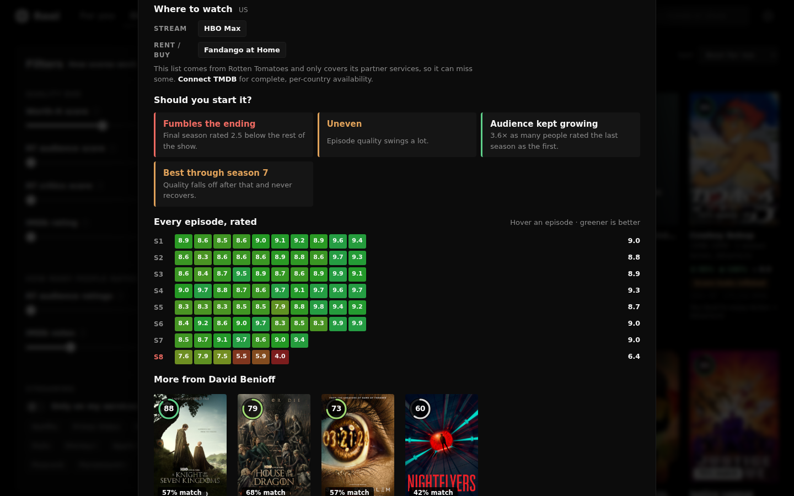

# Reel

Find movies and TV shows worth watching. Set a quality bar once (for example "85%+ audience score from at
least 10,000 people, nothing I've seen"), rate what you've watched with one tap, and Reel only shows what
clears the bar, ranked by how well it fits your taste.

Reel runs on your own computer. Your ratings never leave it.


## Contents

- [Install](#install-no-technical-knowledge-needed)
  - [Step 1 — Install Node.js](#step-1--install-nodejs-one-time)
  - [Step 2 — Download Reel](#step-2--download-reel)
  - [Step 3 — Start Reel](#step-3--start-reel)
  - [Every time after that](#every-time-after-that)
  - [If something goes wrong](#if-something-goes-wrong)
  - [Updating, moving and removing](#updating-moving-and-removing)
- [First steps in the app](#first-steps-in-the-app)
- [Where the data comes from](#where-the-data-comes-from)
- [How scoring works](#how-scoring-works)
- [For developers](#for-developers)
- [Data and licensing notes](#data-and-licensing-notes)
- [Licence](#licence)

---

## Install (no technical knowledge needed)

You need a computer running Windows, macOS or Linux, about **1 GB of free disk space**, and an internet
connection. Setup takes around 10 minutes, most of it waiting.

### Step 1 — Install Node.js (one time)

Reel is built on a free tool called Node.js.

1. Go to **https://nodejs.org/en/download**
2. Download the **LTS** installer for your computer.
3. Open it and click through with the default options.

### Step 2 — Download Reel

1. On this page, click the green **Code** button, then **Download ZIP**.
2. Open your Downloads folder and unzip it:
   - **Windows:** right-click the ZIP → **Extract All…** → **Extract**. (Don't just double-click into it —
     Reel can't run from inside the ZIP.)
   - **Mac:** double-click the ZIP.
3. Move the unzipped folder somewhere you'll find it again, such as Documents.

### Step 3 — Start Reel

Open the folder and double-click the starter for your computer:

| Your computer | Double-click |
| --- | --- |
| Windows | `Start Reel (Windows).bat` |
| Mac | `Start Reel (Mac).command` |
| Linux | run `./start.sh` in a terminal |

A black text window opens. **The first time**, it installs a few components and downloads the movie and TV
catalog (about 700 MB). This takes 3–10 minutes and only happens once. When it's done, Reel opens in your
web browser at **http://localhost:4317**.

**Keep the text window open while you use Reel.** Closing it stops Reel.

### Every time after that

Double-click the same starter. It opens in a few seconds.

### If something goes wrong

| What you see | What to do |
| --- | --- |
| **Windows:** "Windows protected your PC" | Click **More info**, then **Run anyway**. This appears because the starter is a plain script, not a signed app. |
| **Mac:** "cannot be opened because it is from an unidentified developer" | Right-click the starter → **Open** → **Open**. You only need to do this once. |
| **Mac:** nothing happens, or "permission denied" | Open the Terminal app, type `chmod +x ` (with the space), drag the starter file into the window, press Enter, then try again. |
| "Reel needs Node.js" | Do Step 1, then double-click the starter again. |
| The download stops or fails part-way | Just double-click the starter again. It picks up where it left off. |
| The browser doesn't open by itself | Open your browser and go to **http://localhost:4317** |
| "Port 4317 is already in use" | Reel is probably already running in another window. Go to **http://localhost:4317** |

### Updating, moving and removing

- **Fresh ratings and new releases:** delete the file `data/catalog.db` and start Reel again. It rebuilds the
  catalog with the latest data.
- **Your ratings, watchlist and settings** live in `data/user.db`. Copy that file to back it up or move it to
  another computer.
- **Uninstall:** delete the Reel folder. Nothing is installed anywhere else (apart from Node.js).

---

## First steps in the app

1. **Choose where scores come from.** Reel works straight away with IMDb ratings. Turning on Rotten Tomatoes
   adds the audience score, posters and plot summaries (see the note under *Where the data comes from*).
2. **Rate a few things you've seen.** Loved / Liked / Meh / Nope. Five is enough to start; after ten, the
   lists settle down and only change when you ask.
3. **Set your bar in Discover.** Minimum audience score, how many people rated it, genres, length, and which
   streaming services you have. Reel remembers it.

Hover the small **i** next to any filter for an explanation, or click **How scores work**.

## Where the data comes from

| Source | What it adds | Setup |
| --- | --- | --- |
| IMDb open datasets | Catalog, ratings, vote counts, directors, per-episode ratings | Built in. Downloaded to your computer on first start. |
| Rotten Tomatoes | Audience score and how many ratings are behind it, critics score, posters, plots, a partial where-to-watch list | A switch in Settings, **off by default**. Rotten Tomatoes has no public API, so Reel reads each title's public web page from your computer, a few at a time, and remembers the result for two weeks. This is for your own personal use, and turning it on is your choice. |
| TMDB (optional) | Better posters, trailers, accurate where-to-stream for your country, cast, "fans also liked" | Free API key, pasted into Settings |
| OMDb (optional) | Metacritic, age rating, awards | Free API key, pasted into Settings |

## How scoring works

- **Reel score (movies, 0–100)** – audience only. The Rotten Tomatoes audience score and the IMDb rating count
  equally. IMDb ratings are first pulled toward the catalog average when few people have voted, so a 9.0 from
  600 people doesn't outrank an 8.6 from 600,000. Critics scores are shown but never counted.
- **Worth-It score (TV, 0–100)** – show-level scores run high because people who quit rarely rate. Reel looks at
  every episode instead: the episode average, how the final season compares with the rest ("sticks the
  landing" vs "fumbles the ending"), consistency, and whether people were still rating by the last season.
- **Match %** – learned from your ratings: genres and decades you rate up or down, directors and writers
  you've loved, and TMDB "fans also liked" links when a key is connected.



---

## Install for developers

```bash
npm install
npm run reel      # does everything: catalog, build, start, open browser
```

Or step by step:

```bash
npm run catalog   # downloads IMDb datasets and builds data/catalog.db (add -- --refresh to re-download)
npm run build     # builds the UI into dist/
npm start         # serves API + UI on http://localhost:4317
npm run dev       # hot-reload UI on http://localhost:5317, API on 4317
```

Environment variables: `PORT` (default 4317) and `HOST` (default `127.0.0.1`). Reel has no login, so it only
accepts connections from the same computer unless you set `HOST=0.0.0.0` on a network you trust.

- `scripts/launch.mjs` – the one-step launcher used by the starters
- `server/build-catalog.mjs` – builds the catalog database
- `server/providers.mjs` – Rotten Tomatoes / Wikidata / TMDB / OMDb lookups and caching
- `server/tvstats.mjs` – episode-level TV analytics
- `server/engine.mjs` – taste profile, scoring, candidate ranking
- `server/index.mjs` – API, and serves the built UI
- `client/src` – React UI
- `data/` – catalog, your ratings and cached scores (git-ignored)

## Data and licensing notes

Reel ships no movie data. Each copy downloads IMDb's datasets, which IMDb licenses for personal,
non-commercial use, directly to the user's own machine. The Rotten Tomatoes option is off by default and is
not endorsed by or affiliated with Rotten Tomatoes. A hosted or commercial version would need licensed data
sources (TMDB offers commercial terms) and user accounts.

## Licence

[MIT](LICENSE). The licence covers Reel's code only, not the data it downloads.
