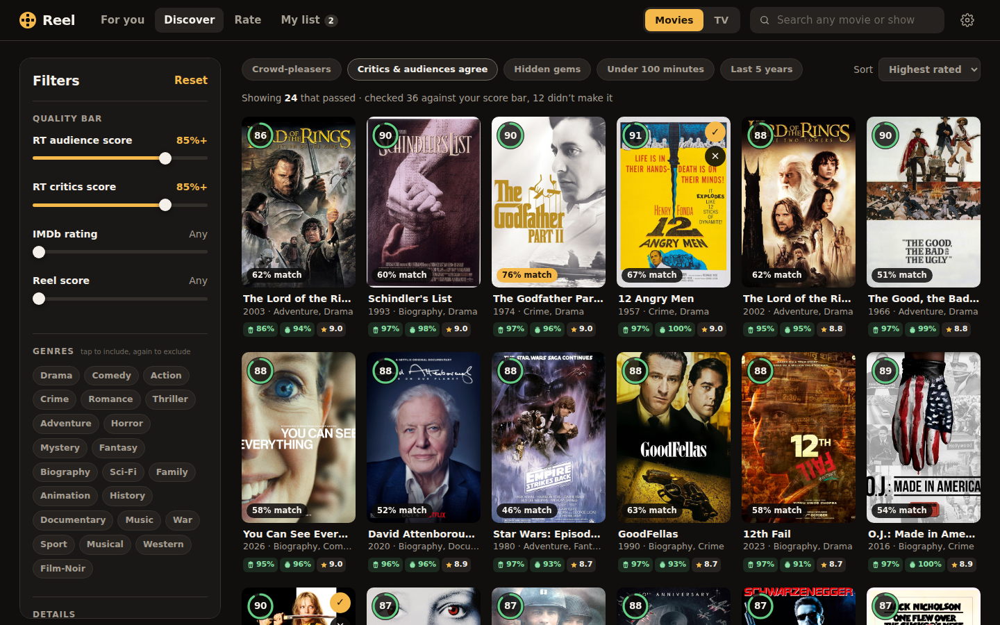

# Reel

Find movies and TV shows worth watching. Set a quality bar once (for example "85%+ audience score from at
least 10,000 people, nothing I've seen"), rate what you've watched with one tap, and Reel only shows what
clears the bar, ranked by how well it fits your taste.

Reel runs on your own computer. Your ratings never leave it.



---

## Install

You need **Node.js 20 or newer** ([download the LTS version](https://nodejs.org/en/download)), about
**1 GB of free disk space**, and an internet connection. Works on Windows, macOS and Linux.

Not sure if you have Node.js? Open a terminal and run `node --version`. If it prints `v20` or higher, you're
set.

> **Opening a terminal** — Windows: press Start, type `PowerShell`, press Enter. Mac: press Cmd+Space, type
> `Terminal`, press Enter. Then paste each command below and press Enter.

### 1. Get the code

With git:

```bash
git clone https://github.com/png-savvy/reel.git
```

```bash
cd reel
```

No git? On the GitHub page click **Code → Download ZIP**, unzip it, and `cd` into the unzipped folder instead
(for example `cd Downloads/reel-master`).

### 2. Install and start

```bash
npm install
```

```bash
npm run reel
```

`npm run reel` does the rest. **The first time**, it downloads the movie and TV catalog (about 700 MB) and
builds a local database, which takes 3–10 minutes and only happens once. Then it starts Reel and opens
**http://localhost:4317** in your browser.

Leave the terminal open while you use Reel. Press **Ctrl+C** in it to stop.

### Every time after that

From the `reel` folder:

```bash
npm run reel
```

It starts in a few seconds.

### Troubleshooting

| What you see | What to do |
| --- | --- |
| `node` or `npm` "is not recognized" / "command not found" | Node.js isn't installed, or the terminal was open while you installed it. Install it, then close and reopen the terminal. |
| "Reel needs Node.js 20 or newer" | Install the current LTS from nodejs.org and try again. |
| `npm install` fails while building `better-sqlite3` | You're on a Node.js version without a ready-made build. Switch to the current LTS version. |
| The catalog download stops or fails part-way | Run `npm run reel` again. Files already downloaded are kept. |
| The browser doesn't open by itself | Go to **http://localhost:4317** yourself. |
| "Port 4317 is already in use" | Reel is already running in another terminal. Open **http://localhost:4317**, or start on another port: `PORT=4400 npm run reel` (PowerShell: `$env:PORT=4400; npm run reel`). |

### Updating, moving and removing

- **Newer version of Reel:** `git pull`, then `npm install`, then `npm run reel`.
- **Fresh ratings and new releases:** delete `data/catalog.db` and run `npm run reel`; it rebuilds the catalog
  with the latest data.
- **Your ratings, watchlist and settings** live in `data/user.db`. Copy that file to back it up or move it to
  another computer.
- **Uninstall:** delete the folder. Nothing is installed anywhere else.

---

## First steps in the app

1. **Choose where scores come from.** Reel works straight away with IMDb ratings. Turning on Rotten Tomatoes
   adds the audience score, posters and plot summaries (see the note under *Where the data comes from*).
2. **Rate a few things you've seen.** Loved / Liked / Meh / Nope. Five is enough to start; after ten, the
   lists settle down and only change when you ask.
3. **Set your bar in Discover.** Minimum audience score, how many people rated it, genres, length, and which
   streaming services you have. Reel remembers it.

Hover the small **i** next to any filter for an explanation, or click **How scores work**.

## Where the data comes from

| Source | What it adds | Setup |
| --- | --- | --- |
| IMDb open datasets | Catalog, ratings, vote counts, directors, per-episode ratings | Built in. Downloaded to your computer on first start. |
| Rotten Tomatoes | Audience score and how many ratings are behind it, critics score, posters, plots, a partial where-to-watch list | A switch in Settings, **off by default**. Rotten Tomatoes has no public API, so Reel reads each title's public web page from your computer, a few at a time, and remembers the result for two weeks. This is for your own personal use, and turning it on is your choice. |
| TMDB (optional) | Better posters, trailers, accurate where-to-stream for your country, cast, "fans also liked" | Free API key, pasted into Settings |
| OMDb (optional) | Metacritic, age rating, awards | Free API key, pasted into Settings |

## How scoring works

- **Reel score (movies, 0–100)** – audience only. The Rotten Tomatoes audience score and the IMDb rating count
  equally. IMDb ratings are first pulled toward the catalog average when few people have voted, so a 9.0 from
  600 people doesn't outrank an 8.6 from 600,000. Critics scores are shown but never counted.
- **Worth-It score (TV, 0–100)** – show-level scores run high because people who quit rarely rate. Reel looks at
  every episode instead: the episode average, how the final season compares with the rest ("sticks the
  landing" vs "fumbles the ending"), consistency, and whether people were still rating by the last season.
- **Match %** – learned from your ratings: genres and decades you rate up or down, directors and writers
  you've loved, and TMDB "fans also liked" links when a key is connected.


---

## For developers

`npm run reel` runs `scripts/launch.mjs`, which is just these steps with checks around them:

```bash
npm run catalog   # downloads IMDb datasets and builds data/catalog.db (add -- --refresh to re-download)
npm run build     # builds the UI into dist/
npm start         # serves API + UI on http://localhost:4317
```

For UI work, `npm run dev` gives hot reload on http://localhost:5317 with the API on 4317.

Environment variables: `PORT` (default 4317) and `HOST` (default `127.0.0.1`). Reel has no login, so it only
accepts connections from the same computer unless you set `HOST=0.0.0.0` on a network you trust.

- `scripts/launch.mjs` – the one-step launcher behind `npm run reel`
- `server/build-catalog.mjs` – builds the catalog database
- `server/providers.mjs` – Rotten Tomatoes / Wikidata / TMDB / OMDb lookups and caching
- `server/tvstats.mjs` – episode-level TV analytics
- `server/engine.mjs` – taste profile, scoring, candidate ranking
- `server/index.mjs` – API, and serves the built UI
- `client/src` – React UI
- `data/` – catalog, your ratings and cached scores (git-ignored)

## Data and licensing notes

Reel ships no movie data. Each copy downloads IMDb's datasets, which IMDb licenses for personal,
non-commercial use, directly to the user's own machine. The Rotten Tomatoes option is off by default and is
not endorsed by or affiliated with Rotten Tomatoes. A hosted or commercial version would need licensed data
sources (TMDB offers commercial terms) and user accounts.

## Licence

[MIT](LICENSE). The licence covers Reel's code only, not the data it downloads.
